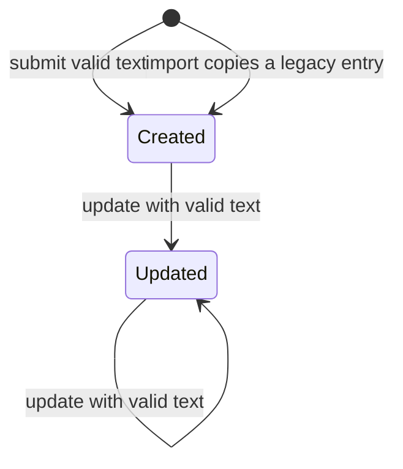
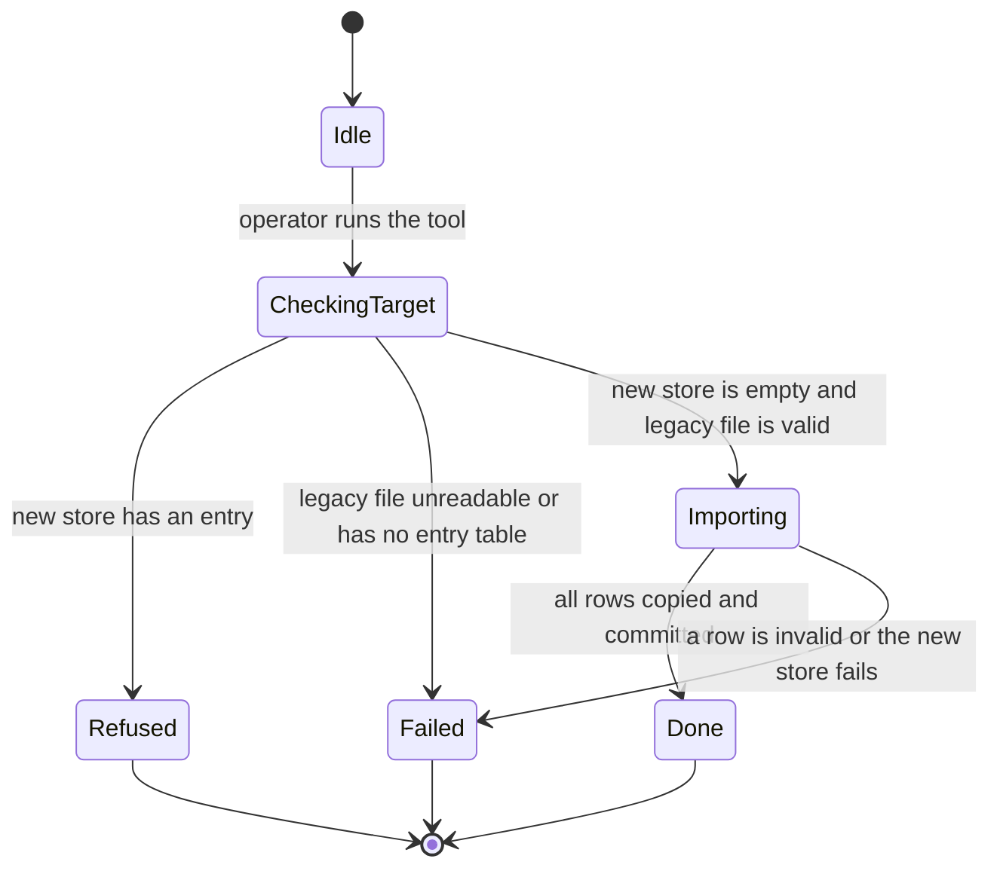

# State machines

UI state machines (form, paging) are in `../04-design/ui-ux.md`.

## Entry lifecycle

| State | Event | Guard | Action | Next state |
|-------|-------|-------|--------|------------|
| (none) | submit | text is valid (BR-SUB-1) | assign id, set creation instant, set update instant equal to it, store | Created |
| (none) | submit | text is whitespace only | reject with `empty_text` | (none) |
| (none) | submit | store fails | reject with `store_unavailable` | (none) |
| (none) | import | import is allowed (see "Legacy import") | copy id, text and creation instant, set update instant equal to creation instant | Created |
| (none) | update | the entry id does not exist | respond `not_found` | (none) |
| Created | update | text is valid | store text, set update instant | Updated |
| Updated | update | text is valid | store text, set update instant | Updated |
| Created, Updated | update | text is whitespace only | reject with `empty_text`, keep stored text | same state |
| Created, Updated | update | store fails | reject with `store_unavailable`, keep stored text | same state |

An entry never returns to "(none)". Version 1 has no delete.
The state "Created" means the update instant equals the creation instant. The state "Updated" means an update has set it.
An imported entry is in state "Created", also when its text is whitespace only (TS-TEXT-5).

## Legacy import

| State | Event | Guard | Action | Next state | Reason code |
|-------|-------|-------|--------|------------|-------------|
| Idle | run | none | open the new store | Checking target | |
| Checking target | checked | new store has an entry | none | Refused | `target_not_empty` |
| Checking target | checked | legacy file is missing or unreadable | none | Failed | `legacy_unreadable` |
| Checking target | checked | legacy file has no entry table | none | Failed | `legacy_table_missing` |
| Checking target | checked | new store is empty and legacy file is valid | start one transaction | Importing | |
| Importing | all rows copied | none | commit, report the count | Done | |
| Importing | row is invalid | none | roll back, report | Failed | `entry_invalid` |
| Importing | new store fails | none | roll back, report | Failed | `target_unavailable` |

Final states: Done, Refused, Failed. In Refused and in Failed the new store and the legacy file are as before the run.
The import runs once per new store. A second run finds entries and ends in Refused.
