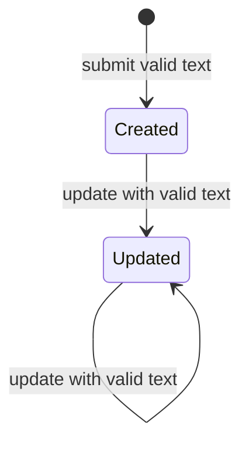

# State machines

Phase 3 adds the import machine.

## Entry lifecycle

| State | Event | Guard | Action | Next state |
|-------|-------|-------|--------|------------|
| (none) | submit | text is valid (BR-SUB-1) | assign id, set creation instant, store | Created |
| (none) | submit | text is whitespace only | reject with `empty_text` | (none) |
| (none) | submit | store fails | reject with `store_unavailable` | (none) |
| Created | update | text is valid | store text | Updated |
| Updated | update | text is valid | store text | Updated |

An entry never returns to "(none)". Version 1 has no delete. The update events belong to phase 3.
