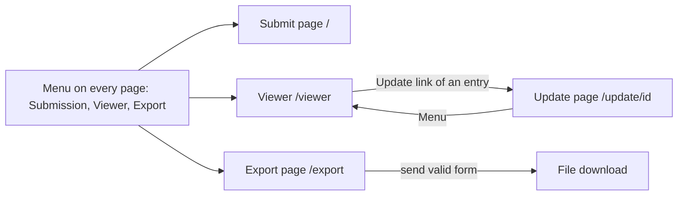

# UI sketch (draft)

Final copy, accessibility and UI state machines are in `../04-design/ui-ux.md` (phase 5).

## Sitemap



The routes are a draft. The OpenAPI file fixes them in phase 5.

## Submit page

```text
+----------------------------------------------+
| Submission | Viewer | Export                 |
+----------------------------------------------+
| [ status message                           ] |
| +------------------------------------------+ |
| | (text area)                              | |
| +------------------------------------------+ |
| [ Submit ]                                   |
+----------------------------------------------+
```

## Viewer page

```text
+----------------------------------------------------------+
| Submission | Viewer | Export                             |
+----------------------------------------------------------+
| > Show filters   (limit [10], offset [0]  [Show])        |
| [Latest] [Previous]              (only when offset > 0)  |
| Total notes: 25                                          |
| +---------------------+------------------+---------+     |
| | Time                | Note             | Actions |     |
| +---------------------+------------------+---------+     |
| | 2026-01-05 (Mon)    | text, line       | Update  |     |
| | 10:30:00            | breaks kept      |         |     |
| +---------------------+------------------+---------+     |
| [Next]                      (only while more entries)    |
+----------------------------------------------------------+
Empty diary: "No entries yet." and no paging links.
```

## Update page

```text
+----------------------------------------------+
| Submission | Viewer | Export                 |
+----------------------------------------------+
| Update entry 2                               |
| [ status message                           ] |
| +------------------------------------------+ |
| | (text area with the current text)        | |
| +------------------------------------------+ |
| [ Update ]                                   |
+----------------------------------------------+
Unknown id: a "not found" page.
```

## Export page

```text
+----------------------------------------------+
| Submission | Viewer | Export                 |
+----------------------------------------------+
| [ message when the last request was invalid] |
| Created since: [ date input ]                |
| Order:         ( ) Ascending (o)  ( ) Descending |
| Format:        [ Markdown diary.md  v ]      |
|                  Tab-separated diary.tsv     |
| [ Export ]                                   |
+----------------------------------------------+
A valid request downloads the file and leaves the page as it is.
```
