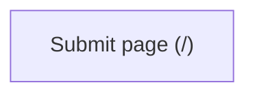

# UI sketch (draft)

Phase 3 adds the browse, update and export pages.

## Sitemap



## Submit page

```text
+----------------------------------------------+
| Diary                                        |
+----------------------------------------------+
| [ status message                           ] |
| +------------------------------------------+ |
| | (text area)                              | |
| |                                          | |
| +------------------------------------------+ |
| [ Submit ]                                   |
+----------------------------------------------+
```

Elements: status message, text area for the entry text, submit button.
Final copy and accessibility are in `../04-design/ui-ux.md`.
