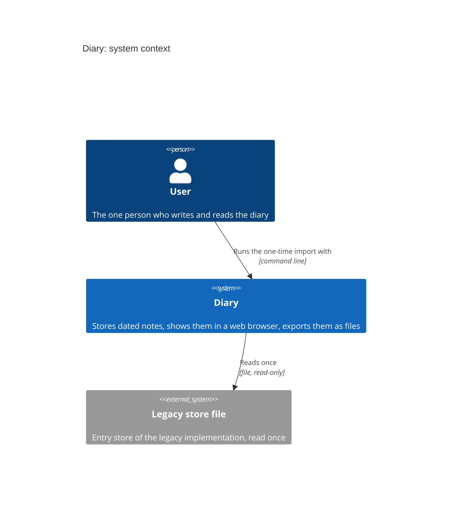
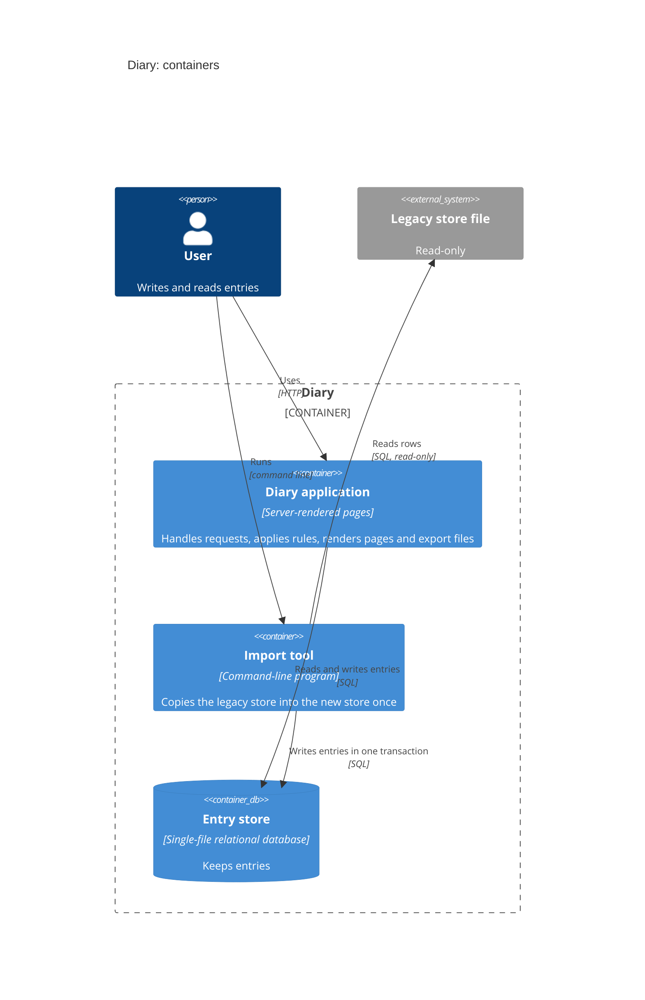
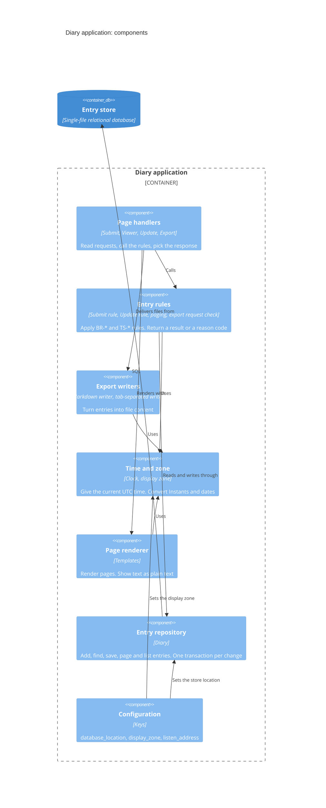

# C4 views

## Level 1: System context

## Level 2: Containers

The Diary application and the Import tool share the rules and the schema (see `../04-design/lld.md`).
They are not run at the same time on the same store.

## Level 3: Components of the Diary application

| Component | Responsibility | Requirements |
|-----------|----------------|--------------|
| Page handlers | Map requests to rule calls and rule results to responses (page, redirect, file, "not found"). | REQ-SUB-003, REQ-UPD-003, REQ-EXP-009 |
| Entry rules | Check text, set instants, clamp paging, check the export request. | REQ-SUB-002, REQ-UPD-004, REQ-BRW-004, REQ-EXP-009 |
| Export writers | Write header rows, escape text, write timestamps. | REQ-EXP-004 to REQ-EXP-008, REQ-EXP-010 |
| Time and zone | Current UTC time. Show an Instant in the display zone. Start of a date. | REQ-NFR-001, REQ-NFR-002 |
| Page renderer | Render pages with plain-text entry text. | REQ-BRW-003, REQ-NFR-003 |
| Entry repository | Keep entries. Order by creation instant, then id. Atomic changes. | REQ-NFR-005, INV-8 |
| Configuration | Read the keys. Stop at start if `display_zone` is unknown. | REQ-NFR-002, REQ-NFR-004 |

The Import tool has these components: argument reader, legacy reader (read-only), row check, entry writer (uses the Entry repository schema), reporter.
Its behaviour is the state machine "Legacy import" in `../02-specification/state-machines.md`.
