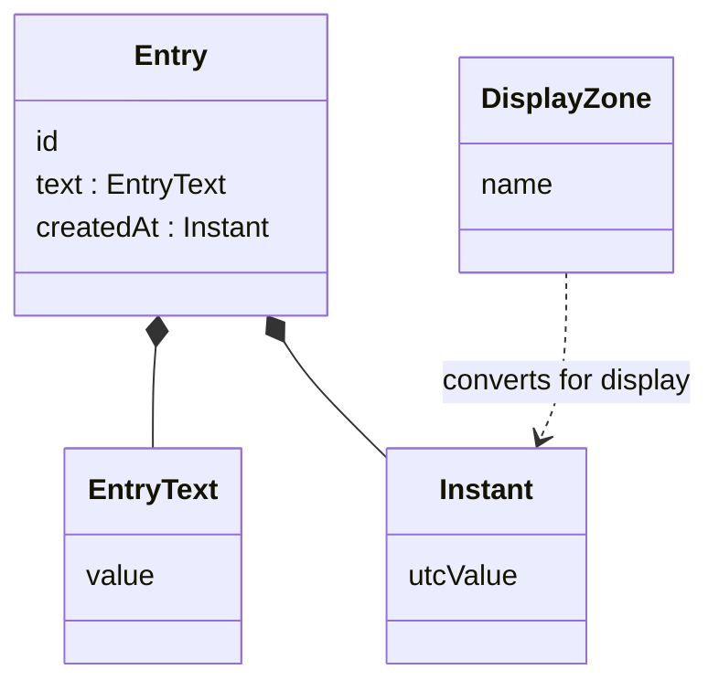

# Domain model (conceptual draft)

Phase 4 refines this file with aggregates and invariants.

| Element | Meaning | Rules |
|---------|---------|-------|
| Entry | One diary note. | Has a unique id. Id never changes. |
| EntryText | The words of an entry. | Never empty and never whitespace only. Kept exactly as entered. |
| Instant | A point in time. | Stored in UTC. The system clock sets it when the entry is created. |
| DisplayZone | The time zone for showing an Instant to the user. | Used only for display. Never stored with an entry. Default: `America/Montreal`. |
