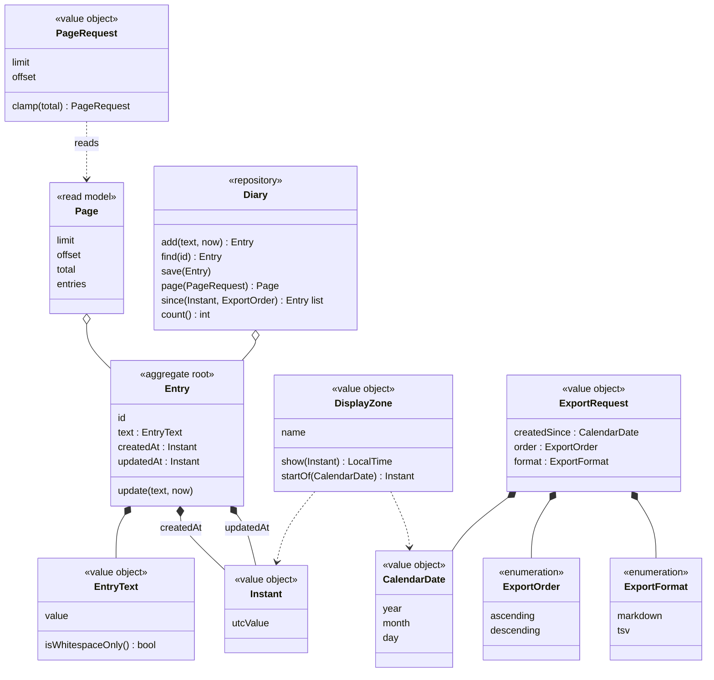

# Domain model

Refined in phase 4. Terms are in `../glossary.md`. Requirements are in `../01-requirements/requirements.md`.

## Model

## Aggregate

`Entry` is the only aggregate. Each change touches one entry. There is no rule that spans two entries.
`Diary` is the repository for entries. It is not an object with state of its own.

## Invariants

| ID | Invariant | Source |
|----|-----------|--------|
| INV-1 | The id of an entry is unique and never changes. | REQ-UPD-008, BR-SUB-4 |
| INV-2 | The creation instant of an entry never changes. | REQ-UPD-008, TS-TIME-4 |
| INV-3 | The update instant equals the creation instant until the first update. After an update it is the time of that update. | REQ-UPD-002, TS-TIME-5 |
| INV-4 | The text of an entry that the user submits or updates is not whitespace only. An imported entry is exempt. | REQ-SUB-002, REQ-UPD-004, TS-TEXT-5 |
| INV-5 | The text of an entry is kept exactly as entered. | REQ-SUB-005, REQ-UPD-005, TS-TEXT-2 |
| INV-6 | Every Instant is in UTC. | REQ-NFR-001 |
| INV-7 | A page has `limit` from 1 to 100 and `offset` from 0 to total minus 1 (0 when the total is 0). | REQ-BRW-004, TS-PAGE-3, TS-PAGE-4 |
| INV-8 | A change of the diary is atomic. A failure leaves the diary as it was. | TS-NFR-4, REQ-IMP-005 |
| INV-9 | The system confirms a write only after the entry store holds it. | REQ-NFR-005 |

## Elements

| Element | Meaning | Rules |
|---------|---------|-------|
| Entry | One diary note. | INV-1 to INV-5. |
| EntryText | The words of an entry. | `isWhitespaceOnly` is true when every character is space, tab, line feed or carriage return (TS-TEXT-3). The empty text is whitespace only. |
| Instant | A point in time. | UTC. Resolution of one microsecond in the store. |
| DisplayZone | The zone for showing an Instant and for reading a date. | Never stored with an entry. `startOf` follows TS-DATE-3. Default `America/Montreal`. |
| CalendarDate | A date with no time and no zone. | Valid when it exists in the Gregorian calendar (TS-DATE-2). |
| PageRequest | The `limit` and `offset` that the user asks for. | `clamp(total)` applies TS-PAGE-1 to TS-PAGE-4. |
| Page | The entries of one page, with the effective `limit`, `offset` and the total. | Newest first (BR-BRW-1). |
| ExportRequest | The date, order and format of an export. | Order ascending unless the user chooses descending. |
| Diary | The repository of entries. | Orders by creation instant, then id (BR-BRW-1, BR-EXP-1). |

## Domain services (no state)

| Service | Job | Requirements |
|---------|-----|--------------|
| Submit rule | Check the text, set the instants, add the entry. | REQ-SUB-001 to REQ-SUB-006 |
| Update rule | Find the entry, check the text, set the update instant, save. | REQ-UPD-001 to REQ-UPD-008 |
| Export writer | Turn a list of entries into file content for a format. | REQ-EXP-004 to REQ-EXP-010 |
| Legacy import | Copy legacy rows into an empty diary in one transaction. | REQ-IMP-001 to REQ-IMP-007 |

## Rejections

Every refusal has a reason code. The codes are the contract between the layers.

| Code | Raised by |
|------|-----------|
| `empty_text` | Submit rule, Update rule |
| `not_found` | Update rule |
| `store_unavailable` | Any use of the Diary |
| `invalid_date`, `invalid_format` | Export |
| `target_not_empty`, `legacy_unreadable`, `legacy_table_missing`, `entry_invalid`, `target_unavailable` | Legacy import |
| `schema_too_new`, `migration_failed` | Store start-up check (the system and the Import tool) |

## Decision

The Entry has no field beyond `id`, `text`, `createdAt` and `updatedAt` in version 1 (phase 2 review).
