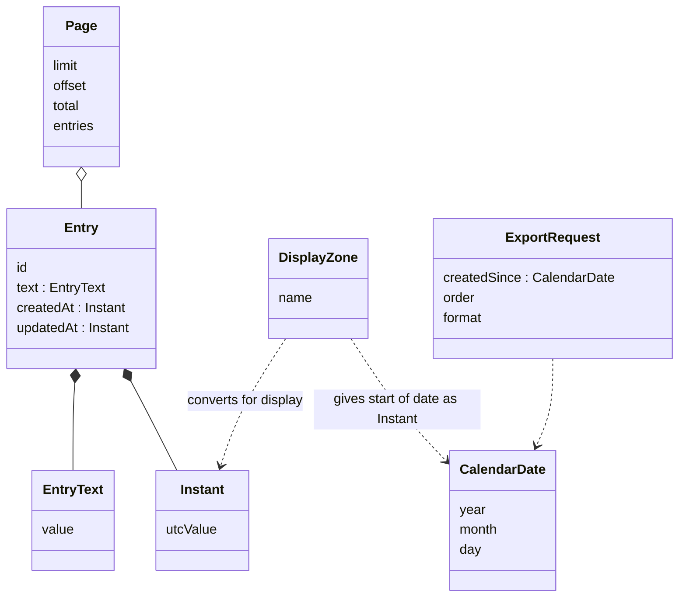

# Domain model (conceptual draft)

Phase 4 refines this file with aggregates and invariants.

| Element | Meaning | Rules |
|---------|---------|-------|
| Entry | One diary note. | Has a unique id. Id never changes (REQ-UPD-008). |
| EntryText | The words of an entry. | Never empty and never whitespace only when the user submits or updates it. Kept exactly as entered. An imported legacy entry may break the first rule (TS-TEXT-5). |
| Instant | A point in time. | Stored in UTC (REQ-NFR-001). |
| createdAt | Instant when the entry was first stored. | Set once. Never changes (REQ-UPD-008). |
| updatedAt | Instant of the last change of the text. | Equals `createdAt` until the first update. Set by each update (REQ-UPD-002). |
| DisplayZone | The time zone for showing an Instant and for reading a date. | Never stored with an entry. Default `America/Montreal` (REQ-NFR-002). |
| Page | A slice of the diary for the viewer. | `limit` 1 to 100. `offset` 0 to total minus 1. Entries newest first (REQ-BRW-001, REQ-BRW-004). |
| ExportRequest | What the user asks to export. | Has a `createdSince` date, an order (ascending or descending) and a format (Markdown or tab-separated). |
| CalendarDate | A date with no time and no zone. | Becomes an Instant at the start of that date in the display zone (REQ-EXP-002). |

Decision (phase 2 review): the Entry has no field beyond `id`, `text`, `createdAt` and `updatedAt` in version 1.
