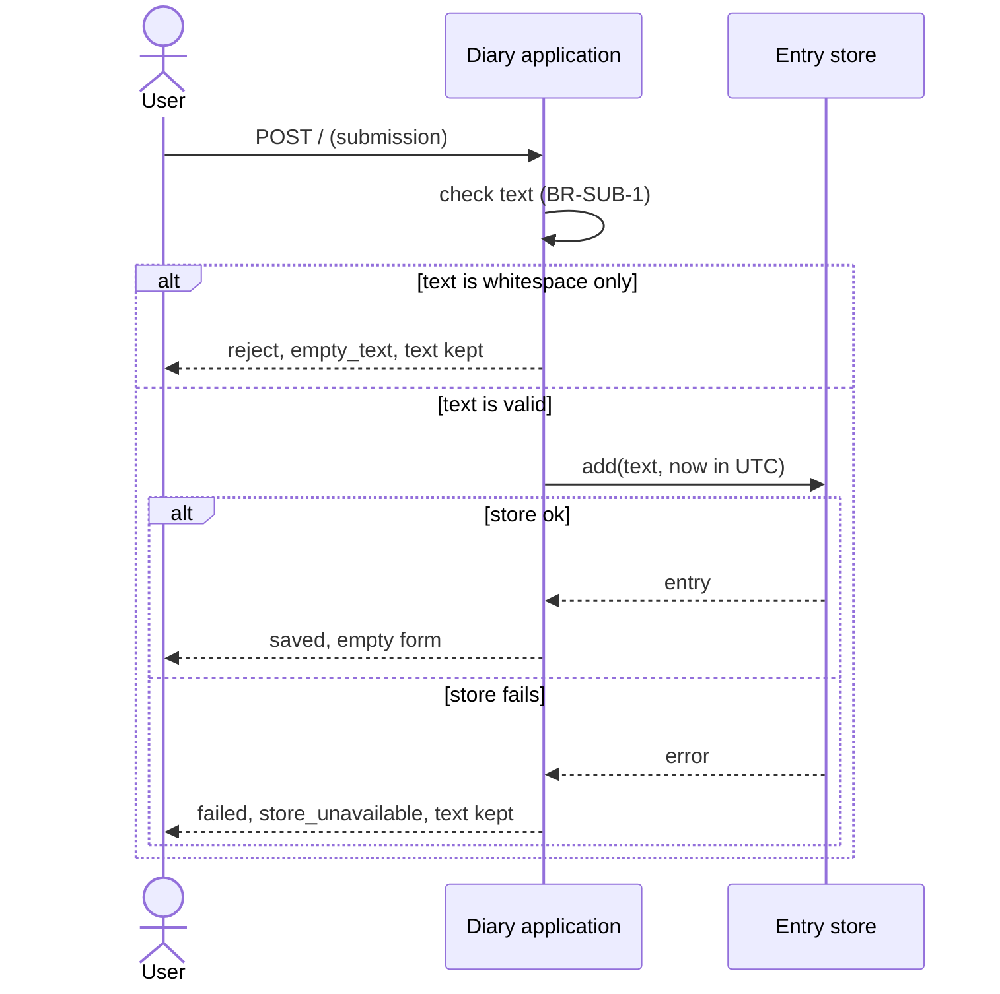

# Low-level design

Phase 5 completes this file.

## Entry store contract

| Operation | Input | Output | Errors |
|-----------|-------|--------|--------|
| `add(text, createdAt)` | entry text, creation Instant (UTC) | the new entry: id, text, createdAt | `store_unavailable` |
| `newest()` | none | the entry with the latest creation instant, or none | `store_unavailable` |
| `count()` | none | number of entries | `store_unavailable` |

`add` is atomic. If it fails, the store holds no partial entry.
`newest` and `count` support scenarios and later features. Phase 5 adds the paging operations.

## Submit rule (pseudocode)

```text
function submit(text):
    if isWhitespaceOnly(text):          # BR-SUB-1, TS-TEXT-3
        return Rejected("empty_text", text)
    now = clock.nowUtc()                # TS-TIME-2
    try:
        entry = store.add(text, now)    # text unchanged, TS-TEXT-2
    catch StoreError:
        return Failed("store_unavailable", text)
    return Saved(entry)

function isWhitespaceOnly(text):
    for each character c in text:
        if c not in {U+0020, U+0009, U+000A, U+000D}:
            return false
    return true
```

## Submit sequence



## HTTP outcomes of `POST /`

| Outcome | Page request (no `Accept: application/json`) | JSON request (`Accept: application/json`) |
|---------|----------------------------------------------|--------------------------------------------|
| Saved | 303 to `/?saved=1` | 201 with `{id, created_at}` |
| `empty_text` | 422 with the form page, the text and the error | 422 with `{error: "empty_text"}` |
| `store_unavailable` | 503 with the form page, the text and the error | 503 with `{error: "store_unavailable"}` |

The 303 goes to `/?saved=1`. When `GET /` has the query parameter `saved=1`, the page shows `Entry saved.`
The parameter holds no entry data. A reload shows the message again. This is harmless.

Requirements: REQ-SUB-001 to REQ-SUB-006.
