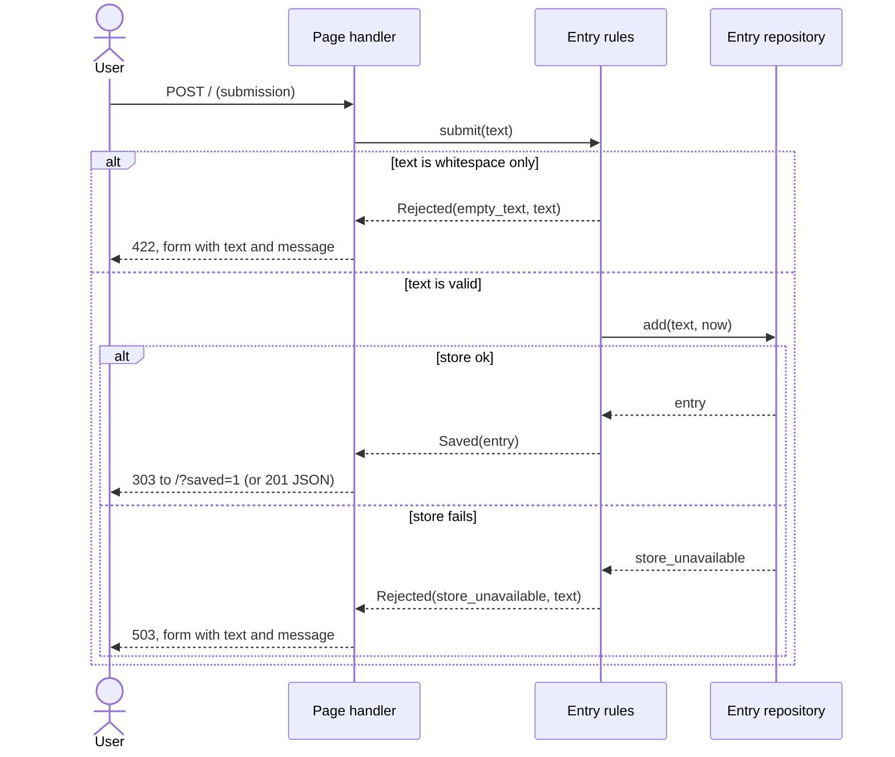
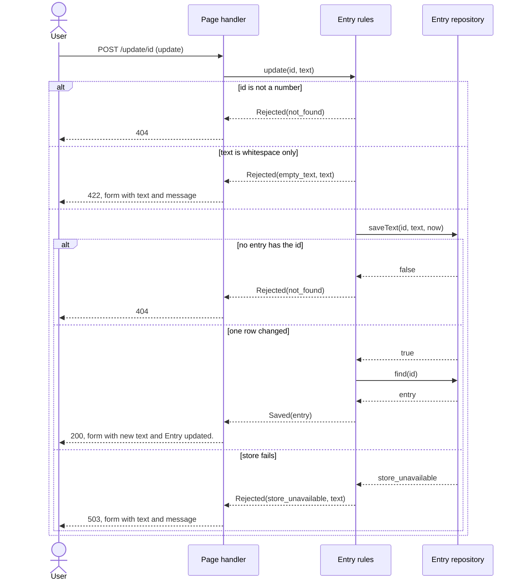
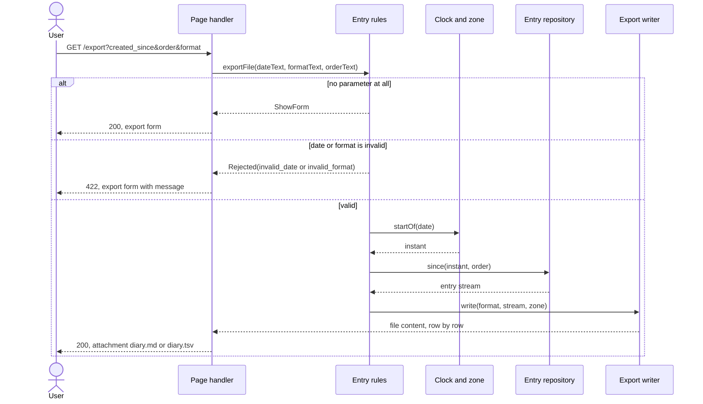
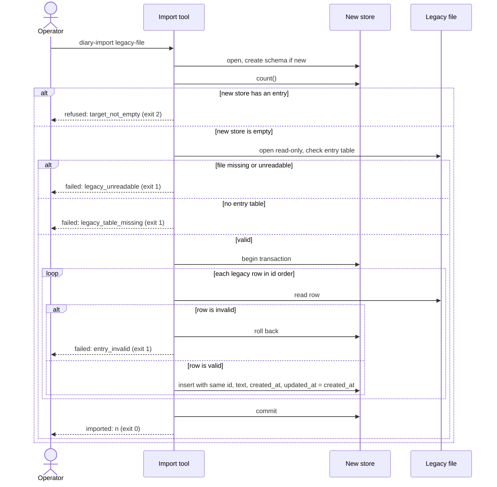

# Low-level design

Contracts, algorithms and sequences. Names are for the spec. An implementation may choose other names.
Components are in `../03-architecture/c4.md` (level 3). Routes are in `api/openapi.yaml`.

## 1. Contracts

### 1.1 Clock and display zone

| Operation | Input | Output | Rule |
|-----------|-------|--------|------|
| `now()` | none | Instant (UTC, microsecond resolution) | TS-TIME-2, TS-TIME-3 |
| `show(instant)` | Instant | local date and time in the display zone, with the offset | TS-TIME-6 |
| `startOf(date)` | CalendarDate | Instant | TS-DATE-3 |

The display zone comes from configuration. An unknown name stops the system at start.

### 1.2 Entry repository

All operations raise `store_unavailable` when the store fails. Each change runs in one transaction (INV-8).

| Operation | Input | Output |
|-----------|-------|--------|
| `add(text, now)` | text, Instant | the new entry. Sets `created_at` and `updated_at` to `now`. The store assigns the id. |
| `find(id)` | integer | the entry, or none |
| `saveText(id, text, now)` | integer, text, Instant | `true` when one row changed, `false` when no entry has the id. Sets `text` and `updated_at`. Never touches `id` or `created_at`. |
| `page(limit, offset)` | effective integers | entries ordered by `created_at` descending, then `id` descending |
| `count()` | none | number of entries |
| `since(instant, order)` | Instant, `ascending` or `descending` | entries with `created_at` at or after `instant`, as a stream, ordered by `created_at`, then `id`, in the given direction |
| `newest()` | none | the entry with the latest `created_at`, then the highest `id`, or none |

`saveText` is one statement, so "find then save" has no gap in which the entry can vanish.

Standard SQL for the central queries:

```sql
INSERT INTO entries (entry_text, created_at, updated_at) VALUES (?, ?, ?);
UPDATE entries SET entry_text = ?, updated_at = ? WHERE id = ?;
SELECT id, entry_text, created_at, updated_at FROM entries
  ORDER BY created_at DESC, id DESC OFFSET ? ROWS FETCH FIRST ? ROWS ONLY;
SELECT COUNT(*) FROM entries;
SELECT id, entry_text, created_at, updated_at FROM entries
  WHERE created_at >= ? ORDER BY created_at ASC, id ASC;
```

An implementation may translate the paging clause to the form of its engine.

### 1.3 Entry rules

| Operation | Input | Output | Rejections |
|-----------|-------|--------|-----------|
| `submit(text)` | text | `Saved(entry)` | `empty_text`, `store_unavailable` |
| `update(id, text)` | id text, text | `Saved(entry)` | `not_found`, `empty_text`, `store_unavailable` |
| `view(limitText, offsetText)` | two optional texts | `Page` | `store_unavailable` |
| `exportFile(dateText, formatText, orderText)` | three optional texts | file name, media type, content stream | `invalid_date`, `invalid_format`, `store_unavailable` |

A rejection carries the reason code and the input text, so that the page can show it again.
`update` reads the id as a non-negative integer in base 10. Any other id text gives `not_found`.

### 1.4 Export writers

| Operation | Input | Output |
|-----------|-------|--------|
| `writeMarkdown(entries, zone, out)` | entry stream, display zone, byte sink | writes the Markdown export (grammar in `../02-specification/technical-spec.md`) |
| `writeTsv(entries, zone, out)` | same | writes the tab-separated export |

A writer writes the header rows first, then one row per entry as it reads the entry (risk R-3). It does not hold all entries in memory.
A writer does not fail on content. Every character has a defined output.

### 1.5 Page handlers

| Handler | Calls | Success response | Rejection response |
|---------|-------|------------------|--------------------|
| Submit page | `submit` | see section 3 | see section 3 |
| Viewer | `view` | page | failure page |
| Update page (show) | `find` | page | not found page |
| Update page (send) | `update` | page | see section 3 |
| Export page | `exportFile` | file | export page with a message |

### 1.6 Import tool

| Operation | Input | Output |
|-----------|-------|--------|
| `importLegacy(legacyPath)` | path | `Done(n)`, `Refused(reason)` or `Failed(reason)` |

Steps and reasons are in `../02-specification/functional-spec.md` (UC-IMP) and `data/legacy-import.md`.
The tool uses the Entry repository schema and one transaction on the new store.

## 2. Algorithms (pseudocode)

### 2.1 Whitespace only (BR-SUB-1, TS-TEXT-3)

```text
function isWhitespaceOnly(text):
    for each character c in text:
        if c not in {U+0020, U+0009, U+000A, U+000D}:
            return false
    return true
```

### 2.2 Clamp limit and offset (TS-PAGE-1 to TS-PAGE-5)

```text
function readInteger(text):                  # text may be absent
    if text is absent or text is not an optional sign followed by digits:
        return none
    return the integer value                 # no upper bound on size; see below

function clamp(limitText, offsetText, total):
    limit  = readInteger(limitText)  or 10
    offset = readInteger(offsetText) or 0
    limit  = min(max(limit, 1), 100)
    last   = max(total - 1, 0)
    offset = min(max(offset, 0), last)
    return (limit, offset)
```

A number too large for the implementation's integer type counts as a very large number. It is clamped like any other.

The viewer reads `total` first, then clamps, then calls `page(limit, offset)` (TS-PAGE-5).
Link targets use the effective values (BR-BRW-2, BR-BRW-3):

```text
next     exists when offset + limit < total  ->  offset + limit
latest   exists when offset > 0              ->  0
previous exists when offset > 0              ->  max(offset - limit, 0)
```

### 2.3 Show a time (REQ-BRW-003, REQ-EXP-008)

```text
function showViewerTime(instant, zone):
    local = convert instant to zone
    return format(local, "YYYY-MM-DD (Ddd) HH:MM:SS")     # Ddd: Mon Tue Wed Thu Fri Sat Sun

function showExportTime(instant, zone):
    local = convert instant to zone
    return format(local, "YYYY-MM-DDTHH:MM:SS") + offsetText(local)
    # offsetText: "+" or "-", then hours and minutes, two digits each, no colon. Zero offset is "+0000".
```

The time has whole seconds. The fraction of a second is dropped, not rounded.

### 2.4 Start of a date (TS-DATE-1 to TS-DATE-3)

```text
function parseDate(text):
    if text does not match 4 digits "-" 2 digits "-" 2 digits:  return invalid
    (y, m, d) = the numbers
    if (y, m, d) is not a date in the Gregorian calendar:      return invalid
    return CalendarDate(y, m, d)

function startOf(date, zone):
    candidate = local date-time (date, 00:00:00) in zone
    if candidate exists in zone:
        return that Instant
    # midnight falls in a gap: the zone moved its clock forward over midnight
    return the first local time of the date that exists in zone, as an Instant
    # if midnight occurs twice, take the first occurrence
```

### 2.5 Check an export request (REQ-EXP-009)

```text
function checkExportRequest(dateText, formatText, orderText):
    if dateText and formatText and orderText are all absent: return ShowForm      # opening the page
    date = parseDate(dateText)         # absent or empty text is invalid
    if date is invalid:                return Rejected("invalid_date")
    if formatText not in {"markdown", "tsv"}: return Rejected("invalid_format")
    order = "descending" if orderText == "descending" else "ascending"
    return Request(date, formatText, order)
```

An order text that is absent or unknown means `ascending`.

### 2.6 Escape text (technical specification, escape table)

```text
function escapeMarkdown(text):
    out = ""
    for each character c in text, left to right:
        if   c == U+005C: out += "\\"      # backslash backslash
        elif c == U+007C: out += "\|"      # backslash pipe
        elif c == U+000A: out += "\n"      # backslash n
        elif c == U+000D: out += "\r"
        elif c == U+0009: out += "\t"
        else:             out += c
    return out

function escapeTsv(text):                  # same, without the pipe rule
    ... c == U+007C: out += c
```

### 2.7 Export a file

```text
function exportFile(dateText, formatText, orderText):
    r = checkExportRequest(...)
    if r is ShowForm or Rejected: return r
    start   = clock/zone.startOf(r.date)
    entries = repository.since(start, r.order)             # stream
    return File(name(r.format), mediaType(r.format),
                write(r.format, entries, zone))
```

## 3. HTTP outcomes

Page requests have no `Accept: application/json`. JSON requests have it (ADR-0004).
The status codes for rejections are the same for both forms.

| Route | Outcome | Page request | JSON request |
|-------|---------|--------------|--------------|
| `GET /` | shown | 200 page (message `Entry saved.` when `saved=1`) | not used |
| `POST /` | saved | 303 to `/?saved=1` | 201 `{id, created_at}` |
| `POST /` | `empty_text` | 422 form page with text and error | 422 `{error}` |
| `POST /` | `store_unavailable` | 503 form page with text and error | 503 `{error}` |
| `GET /viewer` | shown | 200 page | not used |
| `GET /viewer` | `store_unavailable` | 503 failure page | not used |
| `GET /update/{id}` | shown | 200 page | not used |
| `GET /update/{id}` | `not_found` | 404 not found page | not used |
| `GET /update/{id}` | `store_unavailable` | 503 failure page | not used |
| `POST /update/{id}` | updated | 200 form page with new text and message | 200 `{id, updated_at}` |
| `POST /update/{id}` | `not_found` | 404 not found page | 404 `{error}` |
| `POST /update/{id}` | `empty_text` | 422 form page with text and error | 422 `{error}` |
| `POST /update/{id}` | `store_unavailable` | 503 form page with text and error | 503 `{error}` |
| `GET /export` | form (no parameters) | 200 page | not used |
| `GET /export` | file | 200 attachment | not used |
| `GET /export` | `invalid_date`, `invalid_format` | 422 export page with message | not used |
| `GET /export` | `store_unavailable` | 503 export page with message | not used |

`{error}` is the object `{"error": "<reason code>"}`.
The 303 goes to `/?saved=1`. The parameter holds no entry data. A reload shows the message again. This is harmless.
A request for an unknown route gets 404 with the not found page.

## 4. Sequences

### 4.1 Submit



### 4.2 Update



### 4.3 Export



### 4.4 Import



## 5. Requirements covered

REQ-SUB-001 to REQ-SUB-006 (1.3, 2.1, 3, 4.1). REQ-BRW-001 to REQ-BRW-009 (1.2, 2.2, 2.3, 3).
REQ-UPD-001 to REQ-UPD-008 (1.2, 1.3, 3, 4.2). REQ-EXP-001 to REQ-EXP-010 (1.4, 2.3 to 2.7, 3, 4.3).
REQ-IMP-001 to REQ-IMP-007 (1.6, 4.4). REQ-NFR-001 to REQ-NFR-006 (1.1, 1.2, 1.4, 3).
