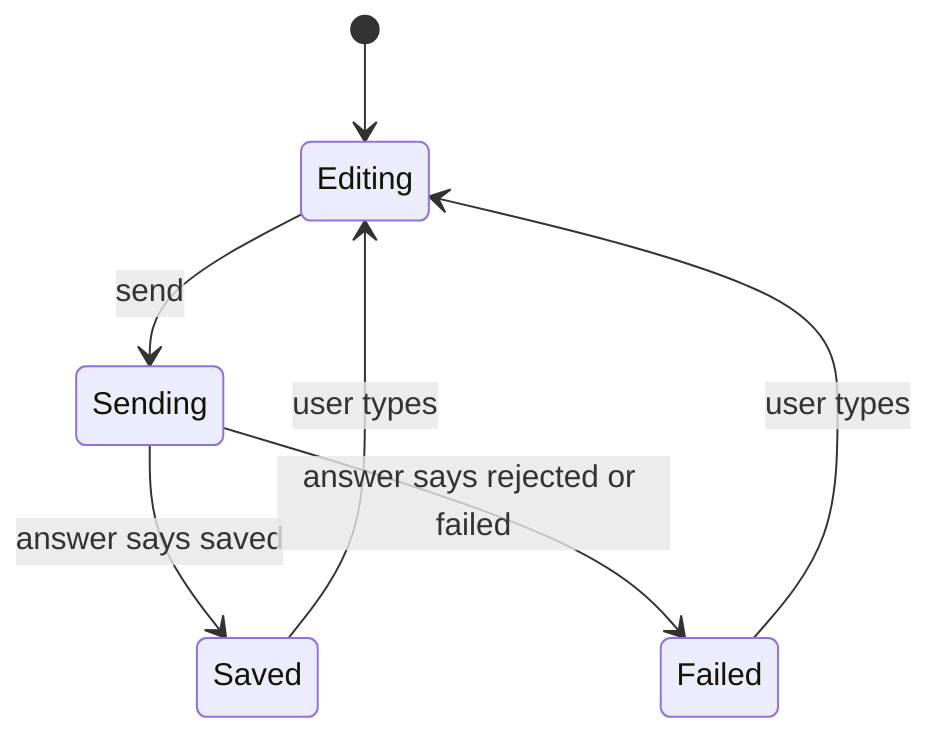

# UI/UX design

Phase 5 completes this file for all pages.

## Submit page (route `/`)

Requirements: REQ-SUB-001 to REQ-SUB-006.

### Layout and copy

| Element | Content |
|---------|---------|
| Page title | `Diary` |
| Status region | Empty at first. Holds the messages below. |
| Text area | Label `Entry` (visible). Name `submission`. Several lines tall. |
| Button | `Submit` |

### Messages

| When | Message | Kind |
|------|---------|------|
| Sending | `Submitting...` | info |
| Saved | `Entry saved.` | success |
| Rejected, `empty_text` | `Write some text before you submit.` | error |
| Failed, `store_unavailable` | `The entry was not saved. Try again.` | error |
| Network failure (script only) | `The entry was not saved. Try again.` | error |

### Machine-readable markers

1. The status region has the id `submission-status`. When it shows a rejection or failure, it has the attribute `data-reason` with the reason code (`empty_text` or `store_unavailable`).
2. The text area has the name `submission`. After an error it holds the typed text.
3. A text area that holds text starts with one line feed that the browser drops. This keeps leading line breaks of the typed text.

### Accessibility

1. The text area has a visible `<label>` linked to it.
2. The status region is a live region (`role="status"` for info and success, `role="alert"` for errors).
3. After an error, the focus moves to the text area. The text stays in it.
4. The page works with the keyboard only.
5. The text area and button have a contrast ratio of at least 4.5:1.

### Behaviour with no script

1. The user sends the form as a normal page post.
2. On success, the system redirects to `/?saved=1`. The page shows the message `Entry saved.` and an empty form.
3. On error, the system answers with the form page, the typed text and the error message.

### Behaviour with script (progressive enhancement)

1. The script catches the send. It disables the button and shows `Submitting...` (REQ-SUB-004).
2. It posts the form with the header `Accept: application/json`.
3. On a 201 answer, it empties the text area and shows `Entry saved.`
4. On any other answer or a network failure, it keeps the text and shows the error message.
5. It enables the button again when the answer arrives.

### Form state machine

| State | Text area | Button | Status |
|-------|-----------|--------|--------|
| Editing | enabled, holds the text | enabled | as before |
| Sending | holds the text | disabled | `Submitting...` |
| Saved | empty | enabled | `Entry saved.` |
| Failed | holds the text | enabled | error message |

Event `send` in state `Sending` is ignored.
