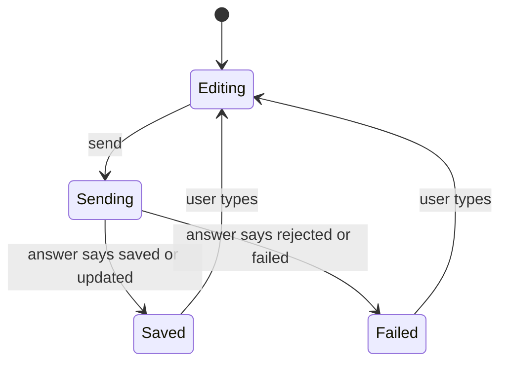
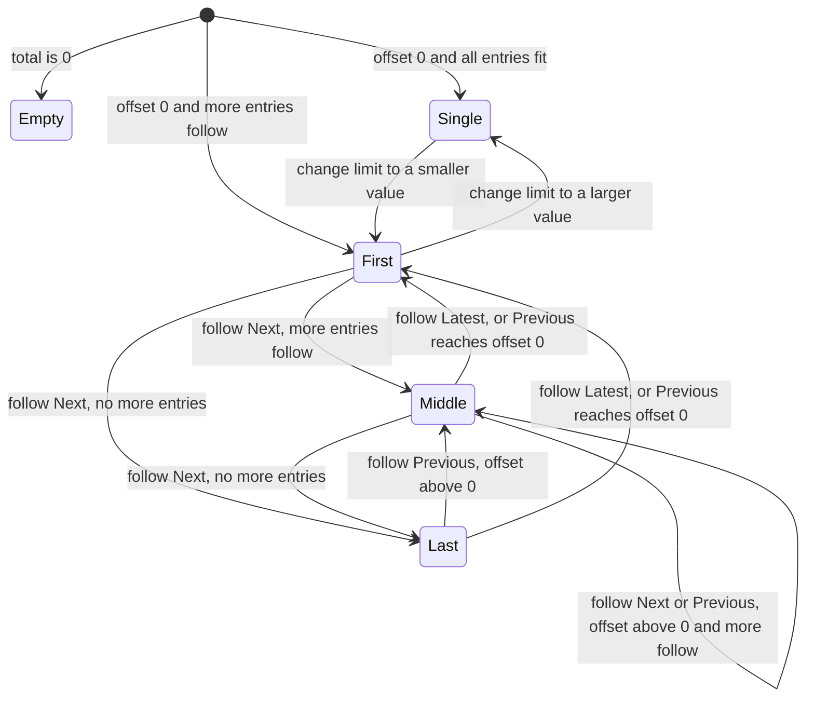

# UI/UX design

Pages, copy, markers, accessibility and UI state machines. Wireframes are in `../02-specification/ui-sketch.md`.
Routes and parameters are in `api/openapi.yaml`.

## Shared elements

### Menu

Every page has a `nav` element with the class `menu` and three links, in this order:

| Link text | Route |
|-----------|-------|
| `Submission` | `/` |
| `Viewer` | `/viewer` |
| `Export` | `/export` |

### Status region

Pages with a form for entry text (submit, update) have a status region with the id `submission-status`.
Its `role` is `status` for info and success, and `alert` for errors.
When it shows a rejection or failure, it has the attribute `data-reason` with the reason code.

### Page language and titles

| Page | Title |
|------|-------|
| Submit | `Diary` |
| Viewer | `Diary | Viewer` |
| Update | `Diary | Update <id>` |
| Export | `Diary | Export` |
| Not found | `Diary | Not found` |

### Accessibility (all pages)

Requirement: REQ-NFR-007. Scenarios: `../features/accessibility.feature`.

1. Every form control has a visible `<label>` linked to it.
2. Status and error regions are live regions (`role="status"` or `role="alert"`).
3. After an error, the focus moves to the first control that needs a fix. The user's input stays in the control.
4. Every page works with the keyboard only. Every page works with no script (TS-NFR-1).
5. Text and controls have a contrast ratio of at least 4.5:1.
6. Each page has one `h1`.
7. The entry table has a header row (`th` with `scope="col"`).
8. Entry text keeps its line breaks and spaces on screen (white space is preserved) and wraps long lines.

## Submit page (route `/`)

Requirements: REQ-SUB-001 to REQ-SUB-006.

| Element | Content |
|---------|---------|
| Heading | `Diary` |
| Status region | Empty at first. Holds the messages below. |
| Text area | Label `Entry` (visible). Name `submission`, id `submission`. Several lines tall. |
| Button | `Submit`, id `submission-button` |

### Messages

| When | Message | Kind |
|------|---------|------|
| Sending (script only) | `Submitting...` | info |
| Saved | `Entry saved.` | success |
| Rejected, `empty_text` | `Write some text before you submit.` | error |
| Failed, `store_unavailable` | `The entry was not saved. Try again.` | error |
| Network failure (script only) | `The entry was not saved. Try again.` | error |

### Machine-readable markers

1. The text area has the name `submission`. After an error it holds the typed text.
2. A text area that holds text starts with one line feed that the browser drops. This keeps leading line breaks of the typed text.

### Behaviour with no script

1. The user sends the form as a normal page post.
2. On success, the system redirects to `/?saved=1`. The page shows `Entry saved.` and an empty form.
3. On error, the system answers with the form page, the typed text and the error message.

### Behaviour with script (progressive enhancement)

1. The script catches the send. It disables the button and shows `Submitting...` (REQ-SUB-004).
2. It posts the form with the header `Accept: application/json`.
3. On a 201 answer, it empties the text area and shows `Entry saved.`
4. On any other answer or a network failure, it keeps the text and shows the error message.
5. It enables the button again when the answer arrives.

### Form state machine (submit and update forms)

Scenarios: `../features/form-script.feature`, and the double send scenarios in `submit.feature` and `update.feature`.

| State | Text area | Button | Status |
|-------|-----------|--------|--------|
| Editing | enabled, holds the text | enabled | as before |
| Sending | holds the text | disabled | `Submitting...` or `Updating...` |
| Saved (submit form) | empty | enabled | `Entry saved.` |
| Saved (update form) | holds the new text | enabled | `Entry updated.` |
| Failed | holds the text | enabled | error message |

Event `send` in state `Sending` is ignored (REQ-SUB-004, REQ-UPD-006).

## Viewer page (route `/viewer`)

Requirements: REQ-BRW-001 to REQ-BRW-009, REQ-NFR-002, REQ-NFR-003.

| Element | Content |
|---------|---------|
| Heading | `Viewer` |
| Controls | A form (method `get`, id `viewer-controls`) in a `details` element with the summary `Show filters`. Inputs: `limit` (label `Limit`, number, min 1, max 100) and `offset` (label `Offset`, number, min 0). Button `Show`. The inputs hold the effective values. |
| Paging links (top) | `Latest` and `Previous`, shown by the rules of BR-BRW-3. |
| Total | The text `Total notes: <n>`. Element id `total`, attribute `data-total` holds `n`. |
| Entry table | Id `entries`. Columns `Time`, `Note`, `Actions`. One row per entry. |
| Paging link (bottom) | `Next`, shown by the rule of BR-BRW-2. |
| Empty message | `No entries yet.` Element id `empty`. Shown instead of the table and the paging links when the diary is empty. |

### Entry row

| Cell | Content |
|------|---------|
| Time | The creation instant in the display zone as `YYYY-MM-DD (Ddd) HH:MM:SS`. |
| Note | The entry text as plain text with line breaks and spaces kept. |
| Actions | A link `Update` to `/update/<id>`. |

The row has the attribute `data-entry-id` with the id. The cells have the classes `time`, `note` and `actions`.

### Paging links

| Link | Id | Target | Shown when |
|------|----|--------|-----------|
| Latest | `link-latest` | `/viewer?limit=<limit>&offset=0` | offset above 0 |
| Previous | `link-previous` | `/viewer?limit=<limit>&offset=<max(offset-limit,0)>` | offset above 0 |
| Next | `link-next` | `/viewer?limit=<limit>&offset=<offset+limit>` | offset plus limit below the total |

`<limit>` and `<offset>` are the effective values (TS-PAGE-3, TS-PAGE-4).

### Messages

| When | Message | Kind |
|------|---------|------|
| Diary is empty | `No entries yet.` | info |
| Store fails (`store_unavailable`) | `Entries could not be read. Try again.` (region id `viewer-message`, `role="alert"`, `data-reason`) | error |

### Pagination view machine

| State | Condition | Latest | Previous | Next |
|-------|-----------|--------|----------|------|
| Empty | total is 0 | no | no | no |
| Single | total above 0, offset 0, offset plus limit at or above total | no | no | no |
| First | offset 0, offset plus limit below total | no | no | yes |
| Middle | offset above 0, offset plus limit below total | yes | yes | yes |
| Last | offset above 0, offset plus limit at or above total | yes | yes | no |

A change in the controls can move the view from any state to any state. The table above gives the links for each state.

## Update page (route `/update/<id>`)

Requirements: REQ-UPD-001 to REQ-UPD-008.

| Element | Content |
|---------|---------|
| Heading | `Update entry <id>` |
| Status region | Id `submission-status`. Empty at first. |
| Text area | Label `Entry`. Name `update`, id `update`. Holds the current text. |
| Button | `Update`, id `submission-button` |

### Messages

| When | Message | Kind |
|------|---------|------|
| Sending (script only) | `Updating...` | info |
| Updated | `Entry updated.` | success |
| Rejected, `empty_text` | `Write some text before you update.` | error |
| Failed, `store_unavailable` | `The entry was not updated. Try again.` | error |
| Network failure (script only) | `The entry was not updated. Try again.` | error |

### Not found page

When no entry has the id, the system answers with status "not found" and a page with the heading `Entry not found.` The page has the menu and the attribute `data-reason="not_found"` on the `main` element.

### Behaviour with no script

1. The user sends the form as a normal page post to `/update/<id>`.
2. On success, the system answers with the same page: the form holds the new text and the status region shows `Entry updated.`
3. On error, the system answers with the form page, the typed text and the error message.

### Behaviour with script

Same as the submit page, with two differences: after success the text area keeps the new text, and the button text and messages are those of the update page.

## Export page (route `/export`)

Requirements: REQ-EXP-001 to REQ-EXP-010.

| Element | Content |
|---------|---------|
| Heading | `Export` |
| Message region | Id `export-message`, `role="alert"`, attribute `data-reason`. Present only after an invalid request. |
| Date | Label `Created since`. Input of type `date`, name `created_since`. |
| Order | Label `Order`. A select, name `order`, options `Ascending` (value `ascending`, chosen) and `Descending` (value `descending`). |
| Format | Label `Format`. A select, name `format`, options `diary.md` (value `markdown`, chosen) and `diary.tsv` (value `tsv`). |
| Button | `Export` |

The form uses method `get` and the action `/export`.

### Messages

| When | Message |
|------|---------|
| `invalid_date` | `Choose a date in the form YYYY-MM-DD.` |
| `invalid_format` | `Choose a format: Markdown or tab-separated.` |
| Store fails | `The export failed. Try again.` (`data-reason="store_unavailable"`) |

After an invalid request the form shows the values that the user sent, where they are valid choices.
A valid request makes the browser download the file. The page stays as it is.

## Marker index

Every marker that a runner uses (TS-RUN-2). The term column uses the step terms of the `@frontend` scenarios (technical-spec, step convention 17).
Do not use other parts of the markup to find an element.

| Page | Term | Marker |
|------|------|--------|
| All | Menu | `nav` with class `menu`. Links by their text: `Submission`, `Viewer`, `Export`. |
| All | Main heading | The one `h1`. |
| All | Page title | The document `title`. |
| Submit | Entry text control | Text area with name `submission` (id `submission`). |
| Submit, Update | Send control | Button with id `submission-button`. |
| Submit, Update | Status message | Element with id `submission-status`. Kind by `role` (`status` or `alert`). Reason by `data-reason`. |
| Update | Entry text control | Text area with name `update` (id `update`). |
| Viewer | Viewer controls | Form with id `viewer-controls`. Inputs with names `limit` and `offset`. |
| Viewer | Total | Element with id `total`. Number in `data-total`. |
| Viewer | Entry table | Table with id `entries`. Column headers are `th` with `scope="col"`. |
| Viewer | Entry row | `tr` with `data-entry-id`. Cells with classes `time`, `note` and `actions`. |
| Viewer | Paging links | Links with ids `link-latest`, `link-previous` and `link-next`. |
| Viewer | Empty message | Element with id `empty`. |
| Viewer | Viewer error | Element with id `viewer-message`. Reason by `data-reason`. |
| Export | Created since control | Input with name `created_since`. |
| Export | Export controls | Selects with names `order` and `format`. |
| Export | Export message | Element with id `export-message`. Reason by `data-reason`. |
| Not found | Not found marker | `main` with `data-reason="not_found"`. |

## Import tool (command line)

| Item | Content |
|------|---------|
| Command | `diary-import <legacy-file>`. The implementation may use another file name. It reads the configured `database_location`. |
| Success output (standard output) | `imported: <n>` and a line feed. `<n>` is the number of entries copied. |
| Refused output (standard error) | `refused: target_not_empty` |
| Failure output (standard error) | `failed: <reason>` with a reason code from UC-IMP |
| Exit status | 0 for Done, 2 for Refused, 1 for Failed |
